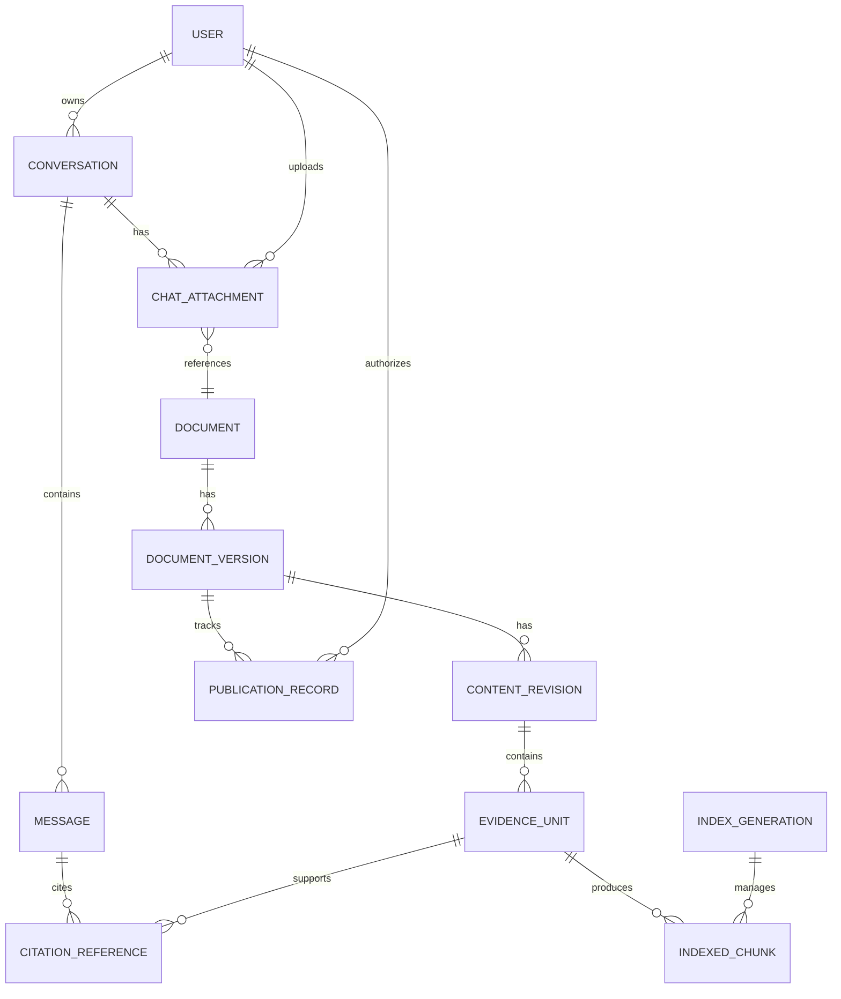

# EngiRAG — Initial Logical ERD

Status: Draft — Pending Team Review

## Entity Relationship Diagram

## Initial Entity Definitions

### 1. User (accounts.User)

Purpose: Represents an authenticated EngiRAG user.

Fields:
- id: BIGINT, Primary Key
- username: VARCHAR, Unique
- email: VARCHAR
- password: VARCHAR (Django password hash)
- is_active: BOOLEAN
- is_staff: BOOLEAN
- date_joined: DATETIME

Implementation:
- Custom User Model based on AbstractUser.
- Django Groups and Permissions manage roles.
- No separate role field is required initially.

### 2. Conversation

Purpose: Stores a private conversation belonging to one user.

Fields:
- id: UUID, Primary Key
- owner_id: BIGINT, Foreign Key -> User.id
- title: VARCHAR, Nullable
- created_at: DATETIME
- updated_at: DATETIME

Relationships:
- One User can own multiple Conversations.
- Each Conversation belongs to exactly one User.

### 3. Message

Purpose: Stores messages within a conversation.

Fields:
- id: UUID, Primary Key
- conversation_id: UUID, Foreign Key -> Conversation.id
- sender_role: ENUM (user, assistant)
- content: TEXT
- created_at: DATETIME

Relationships:
- One Conversation can contain multiple Messages.
- Each Message belongs to exactly one Conversation.

### 4. ChatAttachment

Purpose: Links a private document to a specific conversation.

Fields:
- id: UUID, Primary Key
- conversation_id: UUID, Foreign Key -> Conversation.id
- document_id: UUID, Foreign Key -> Document.id
- uploaded_at: DATETIME

Relationships:
- Each attachment belongs to one Conversation.
- Each attachment references one private Document.

### 5. Document

Purpose: Registers engineering documents and their access scope.

Fields:
- id: UUID, Primary Key
- title: VARCHAR
- visibility_scope: ENUM (PRIVATE_CONVERSATION, SHARED)
- owner_id: BIGINT, Nullable Foreign Key -> User.id
- source_uri: TEXT, Nullable
- created_at: DATETIME

Rules:
- PRIVATE_CONVERSATION documents require an owner.
- SHARED documents are managed through authorized admin operations.
- Private documents must never be automatically published.
- Document access must be checked in the backend.

## Database Integrity and Access Rules

Status: Preliminary Design — Pending Team Review

### 1. Identifier Strategy

- User: BIGINT Primary Key (Django Custom User).
- Conversation: UUID Primary Key.
- Message: UUID Primary Key.
- ChatAttachment: UUID Primary Key.
- Document: UUID Primary Key.
- DocumentVersion: UUID Primary Key.
- ContentRevision: UUID Primary Key.
- EvidenceUnit: UUID Primary Key.
- IndexGeneration: UUID Primary Key.
- IndexedChunk: UUID Primary Key.
- CitationReference: UUID Primary Key.
- PublicationRecord: UUID Primary Key.

Rules:
- Every entity must have a unique identifier.
- Foreign Key types must match referenced Primary Keys.
- Cross-module references must use stable identifiers.
- IDs alone do not grant access to protected data.

### 2. Conversation Integrity

- Conversation.owner_id must reference an existing User.
- Message.conversation_id must reference an existing
  Conversation.
- ChatAttachment.conversation_id must reference an
  existing Conversation.

Access Rules:
- Users may access only their authorized conversations.
- Conversation ownership must be checked in the backend.
- A user cannot read another user's messages.
- Administrators do not automatically gain access to
  private conversations through normal chat permissions.

### 3. Private Document Isolation

Document.visibility_scope must be one of:
- PRIVATE_CONVERSATION
- SHARED

Rules:
- Private documents require an owner_id.
- Shared documents must follow an approved publication flow.
- A ChatAttachment must reference a private document.
- The document owner must match the conversation owner.
- Private attachments remain restricted to their
  designated conversations.
- No automatic private-to-shared publication is allowed.

Enforcement:
- Use database constraints for same-row validity.
- Use backend authorization and transactional validation
  for relationships involving multiple tables.

### 4. Document Version Integrity

- DocumentVersion.document_id is required.
- The pair (document_id, version_number) must be unique.
- ContentRevision.document_version_id is required.
- The pair (document_version_id, revision_number)
  must be unique.

Rules:
- Source versions must remain traceable.
- Correcting extracted content creates a new revision.
- New versions must not automatically become active.
- Historical references must remain resolvable
  according to retention policies.

### 5. Evidence Integrity

- EvidenceUnit.content_revision_id is required.
- Evidence must preserve available source locations.
- Approved and rejected evidence must be distinguishable.
- Rejected evidence is not eligible for retrieval.
- Engineering values and units must preserve their
  documented relationships.

### 6. Index Integrity

- IndexedChunk.index_generation_id is required.
- IndexedChunk must reference its source evidence.
- Embedding dimensions must match the embedding profile.
- Incompatible embedding generations must not be mixed.
- Failed or incomplete indexes must not become active.

Rules:
- Index readiness and document activation are separate.
- Retrieval must apply ownership, visibility, version
  and publication filters.

### 7. Citation Integrity

- CitationReference.message_id is required.
- CitationReference.evidence_unit_id is required.
- Citations must resolve to existing evidence.
- The cited source version must remain identifiable.
- Access permissions must be rechecked before disclosure.
- Unsupported or fabricated references must be rejected.

### 8. Publication Integrity

- PublicationRecord.document_version_id is required.
- PublicationRecord.authorized_by_id is required.
- Only users with the appropriate administrative
  permission may authorize shared publication changes.
- Publication requires applicable evidence validation
  and indexing readiness.
- Unpublication must remove shared retrieval eligibility.

Administrative actions require:
- Authentication
- Backend authorization
- Explicit requested action
- Confirmation when required
- Audit records

### 9. Deletion and Retention

- Document and evidence references must not be silently
  removed when they are needed for active citations.
- Source version history must follow the retention policy.
- Removing shared retrieval eligibility is separate
  from permanently deleting a source document.
- Private conversation deletion and file retention
  behavior require an approved policy before implementation.

### 10. Enforcement Strategy

Database:
- Primary Keys
- Foreign Keys
- Unique Constraints
- Applicable Check Constraints
- Transactional integrity

Django Backend:
- Authentication
- Object ownership validation
- Role and permission checks
- Private/shared scope enforcement
- Publication authorization
- Retrieval eligibility checks

Testing:
- Cross-user access denial
- Cross-conversation attachment isolation
- Unauthorized shared document modification
- Duplicate version prevention
- Invalid citation rejection
- Unpublished document retrieval exclusion

Note:
These rules are logical design requirements.
Exact Django constraints, deletion behavior,
indexes and migrations will be finalized during
physical schema implementation.