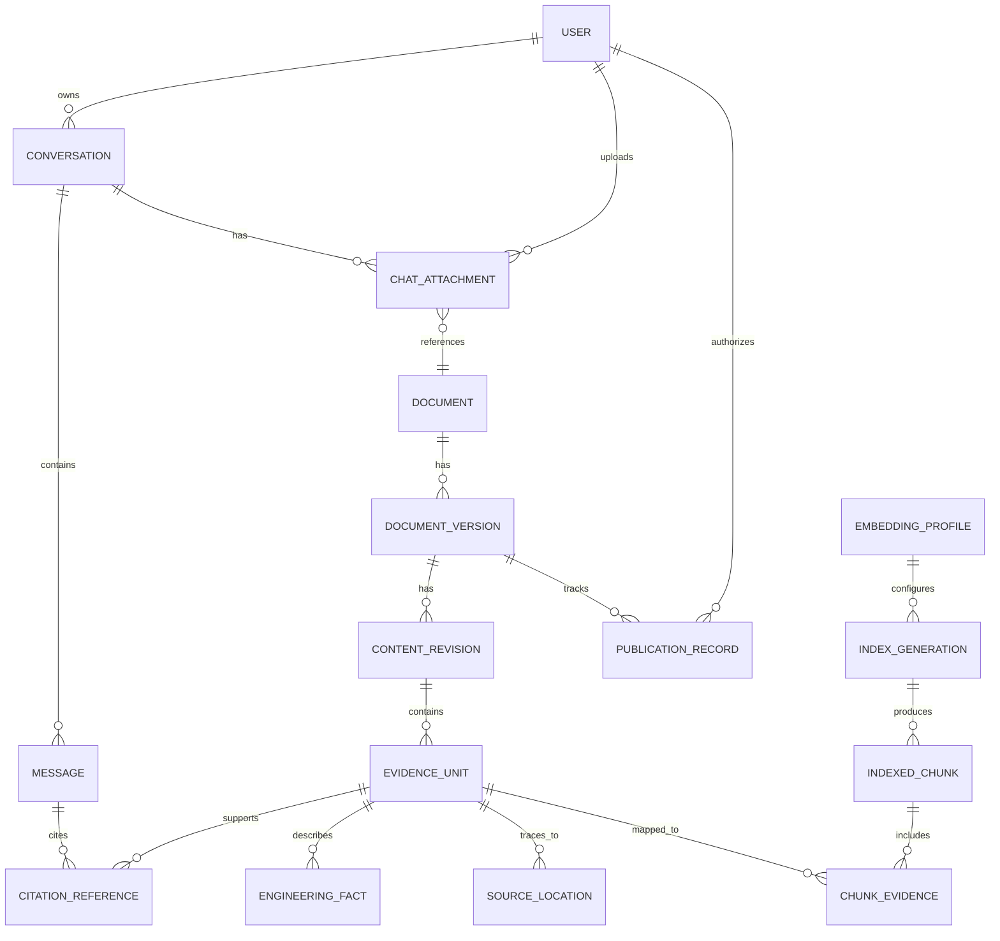

# EngiRAG — Initial Logical ERD

Status: The following preliminary design decisions incorporate feedback from Alzahraa (Document Processing) and Leen (Indexing and Retrieval). Citation and authorization reviews remain pending.

## Entity Relationship Diagram

## Initial Entity Definitions

### 1. User (accounts.User)

Purpose: Represents an authenticated EngiRAG user.

Fields:
- id: BIGINT, Primary Key
- username: VARCHAR, Unique
- email: VARCHAR
- password: VARCHAR (Django password hash)
- is_active: BOOLEAN
- is_staff: BOOLEAN
- date_joined: DATETIME

Implementation:
- Custom User Model based on AbstractUser.
- Django Groups and Permissions manage roles.
- No separate role field is required initially.

### 2. Conversation

Purpose: Stores a private conversation belonging to one user.

Fields:
- id: UUID, Primary Key
- owner_id: BIGINT, Foreign Key -> User.id
- title: VARCHAR, Nullable
- created_at: DATETIME
- updated_at: DATETIME

Relationships:
- One User can own multiple Conversations.
- Each Conversation belongs to exactly one User.

### 3. Message

Purpose: Stores messages within a conversation.

Fields:
- id: UUID, Primary Key
- conversation_id: UUID, Foreign Key -> Conversation.id
- sender_role: ENUM (user, assistant)
- content: TEXT
- created_at: DATETIME

Relationships:
- One Conversation can contain multiple Messages.
- Each Message belongs to exactly one Conversation.

### 4. ChatAttachment

Purpose: Links a private document to a specific conversation.

Fields:
- id: UUID, Primary Key
- conversation_id: UUID, Foreign Key -> Conversation.id
- document_id: UUID, Foreign Key -> Document.id
- uploaded_by_id: BIGINT, Foreign Key -> User.id
- uploaded_at: DATETIME

Relationships:
- Each attachment belongs to one Conversation.
- Each attachment references one private Document.
- The attachment uploader must be authorized to upload into the referenced conversation.

### 5. Document

Purpose: Registers engineering documents and their access scope.

Fields:
- id: UUID, Primary Key
- title: VARCHAR
- visibility_scope: ENUM (PRIVATE_CONVERSATION, SHARED)
- owner_id: BIGINT, Nullable Foreign Key -> User.id
- source_uri: TEXT, Nullable
- created_at: DATETIME

Rules:
- PRIVATE_CONVERSATION documents require an owner.
- SHARED documents are managed through authorized admin operations.
- Private documents must never be automatically published.
- Document access must be checked in the backend.

### 6. DocumentVersion

Purpose: Represents a specific source version of a document.

Fields:
- id: UUID, Primary Key
- document_id: UUID, Foreign Key -> Document.id
- version_label: VARCHAR
- source_sha256: VARCHAR
- created_at: DATETIME

Rules:
- (document_id, version_label) must be unique.
- A source version must remain identifiable even after newer versions are registered.

### 7. ContentRevision

Purpose: Represents a specific extraction or corrected interpretation of a DocumentVersion.

Fields:
- id: UUID, Primary Key
- document_version_id: UUID, Foreign Key -> DocumentVersion.id
- revision_number: INTEGER
- created_at: DATETIME

Rules:
- (document_version_id, revision_number) must be unique.
- Correcting extracted content creates a new ContentRevision without changing the original DocumentVersion.

### 8. EvidenceUnit

Purpose: Stores a traceable unit of extracted engineering evidence.

Fields:
- id: UUID, Primary Key
- content_revision_id: UUID, Foreign Key -> ContentRevision.id
- content: TEXT
- evidence_type: VARCHAR
- language: VARCHAR
- heading_hierarchy: JSON, Nullable
- extraction_method: VARCHAR, Nullable
- extraction_confidence: FLOAT, Nullable
- validation_status: ENUM (PENDING, NEEDS_REVIEW, APPROVED, REJECTED)
- previous_evidence_id: UUID, Nullable

Rules:
- Extraction confidence, when provided, must be between 0 and 1.
- Evidence IDs remain stable within an unchanged ContentRevision.
- Corrected evidence in a new revision may reference earlier evidence for traceability.
- Only approved and traceable evidence is eligible for active retrieval.

### 9. EngineeringFact

Purpose: Preserves structured engineering facts extracted from evidence.

Fields:
- id: UUID, Primary Key
- evidence_unit_id: UUID, Foreign Key -> EvidenceUnit.id
- equipment_identifier: VARCHAR, Nullable
- parameter_name: VARCHAR
- value_text: VARCHAR
- unit: VARCHAR, Nullable
- header_hierarchy: JSON, Nullable

Rules:
- One EvidenceUnit may contain multiple EngineeringFacts.
- Equipment, parameter, value and unit relationships must be preserved.
- Original values and units must not be silently changed during extraction.

### 10. SourceLocation

Purpose: Identifies where an EvidenceUnit originated within the source document.

Fields:
- id: UUID, Primary Key
- evidence_unit_id: UUID, Foreign Key -> EvidenceUnit.id
- pdf_page_index: INTEGER, Nullable
- printed_page_label: VARCHAR, Nullable
- section_reference: VARCHAR, Nullable
- table_reference: VARCHAR, Nullable
- row_reference: VARCHAR, Nullable
- column_reference: VARCHAR, Nullable
- cell_range: VARCHAR, Nullable
- heading_hierarchy: JSON, Nullable

Rules:
- Source locations preserve available page, section and table references.
- Approved evidence must have sufficient verified source information for citation.
- PDF page indices and printed page labels must be distinguished.
- Merged cells and multi-level headers must remain traceable when applicable.

### 11. EmbeddingProfile

Purpose: Defines a reproducible embedding configuration.

Fields:
- id: UUID, Primary Key
- model_name: VARCHAR
- model_revision: VARCHAR
- dimensions: INTEGER
- pooling_strategy: VARCHAR
- normalization: BOOLEAN
- max_tokens: INTEGER
- query_prefix: VARCHAR, Nullable
- passage_prefix: VARCHAR, Nullable
- distance_metric: VARCHAR

Rules:
- Embedding dimensions must match the configured model.
- Incompatible embedding configurations must not be mixed.
- Each IndexGeneration references one EmbeddingProfile.

### 12. IndexGeneration

Purpose: Records a specific indexing build and its configuration.

Fields:
- id: UUID, Primary Key
- embedding_profile_id: UUID, Foreign Key -> EmbeddingProfile.id
- chunking_strategy: VARCHAR
- chunking_version: VARCHAR
- chunk_size: INTEGER, Nullable
- chunk_overlap: INTEGER, Nullable
- corpus_revision: VARCHAR
- index_status: ENUM (BUILDING, READY, FAILED, RETIRED)
- created_at: DATETIME

Rules:
- Only eligible, completed indexes may be activated.
- Index readiness does not automatically imply publication or activation.
- The configuration used for an indexing experiment must remain reproducible.

### 13. IndexedChunk

Purpose: Stores an indexed text chunk and its embedding.

Fields:
- id: UUID, Primary Key
- index_generation_id: UUID, Foreign Key -> IndexGeneration.id
- chunk_text: TEXT
- chunk_order: INTEGER
- embedding: VECTOR

Rules:
- Embedding dimensions must match the associated EmbeddingProfile.
- Each chunk must be traceable to its contributing EvidenceUnits.
- A chunk must not mix different document versions, content revisions or access scopes.
- Obsolete chunks must be excluded from active retrieval.

### 14. ChunkEvidence

Purpose: Implements the many-to-many relationship between IndexedChunk and EvidenceUnit.

Fields:
- id: UUID, Primary Key
- chunk_id: UUID, Foreign Key -> IndexedChunk.id
- evidence_unit_id: UUID, Foreign Key -> EvidenceUnit.id
- evidence_order: INTEGER
- start_offset: INTEGER, Nullable
- end_offset: INTEGER, Nullable

Rules:
- One chunk may contain multiple EvidenceUnits.
- One EvidenceUnit may contribute to multiple chunks.
- Evidence order and source spans must remain traceable.
- Referenced evidence must satisfy indexing eligibility and scope restrictions.

### 15. CitationReference

Purpose: Connects an answer message to supporting evidence.

Fields:
- id: UUID, Primary Key
- message_id: UUID, Foreign Key -> Message.id
- evidence_unit_id: UUID, Foreign Key -> EvidenceUnit.id
- answer_start_offset: INTEGER, Nullable
- answer_end_offset: INTEGER, Nullable

Rules:
- A citation must reference existing, authorized evidence.
- The source document version and content revision must remain traceable.
- Citation references must be verified before being presented to users.
- Claim-level citation requirements remain subject to M5 review.

### 16. PublicationRecord

Purpose: Records authorized publication and unpublication operations for shared document versions.

Fields:
- id: UUID, Primary Key
- document_version_id: UUID, Foreign Key -> DocumentVersion.id
- authorized_by_id: BIGINT, Foreign Key -> User.id
- action: VARCHAR
- created_at: DATETIME

Rules:
- Publication actions require appropriate backend permissions.
- Private documents must never be automatically published.
- Publication history must be auditable.
- Publication records do not independently determine the currently active retrieval state.

## Database Integrity and Access Rules

Status: Preliminary Design — Pending Team Review

### 1. Identifier Strategy

- User: BIGINT Primary Key (Django Custom User).
- Conversation: UUID Primary Key.
- Message: UUID Primary Key.
- ChatAttachment: UUID Primary Key.
- Document: UUID Primary Key.
- DocumentVersion: UUID Primary Key.
- ContentRevision: UUID Primary Key.
- EvidenceUnit: UUID Primary Key.
- IndexGeneration: UUID Primary Key.
- IndexedChunk: UUID Primary Key.
- CitationReference: UUID Primary Key.
- PublicationRecord: UUID Primary Key.

Rules:
- Every entity must have a unique identifier.
- Foreign Key types must match referenced Primary Keys.
- Cross-module references must use stable identifiers.
- IDs alone do not grant access to protected data.

### 2. Conversation Integrity

- Conversation.owner_id must reference an existing User.
- Message.conversation_id must reference an existing
  Conversation.
- ChatAttachment.conversation_id must reference an
  existing Conversation.

Access Rules:
- Users may access only their authorized conversations.
- Conversation ownership must be checked in the backend.
- A user cannot read another user's messages.
- Administrators do not automatically gain access to
  private conversations through normal chat permissions.

### 3. Private Document Isolation

Document.visibility_scope must be one of:
- PRIVATE_CONVERSATION
- SHARED

Rules:
- Private documents require an owner_id.
- Shared documents must follow an approved publication flow.
- A ChatAttachment must reference a private document.
- The document owner must match the conversation owner.
- Private attachments remain restricted to their
  designated conversations.
- No automatic private-to-shared publication is allowed.

Enforcement:
- Use database constraints for same-row validity.
- Use backend authorization and transactional validation
  for relationships involving multiple tables.

### 4. Document Version Integrity

- DocumentVersion.document_id is required.
- The pair (document_id, version_number) must be unique.
- ContentRevision.document_version_id is required.
- The pair (document_version_id, revision_number)
  must be unique.

Rules:
- Source versions must remain traceable.
- Correcting extracted content creates a new revision.
- New versions must not automatically become active.
- Historical references must remain resolvable
  according to retention policies.

### 5. Evidence Integrity

- EvidenceUnit.content_revision_id is required.
- Evidence must preserve available source locations.
- Approved and rejected evidence must be distinguishable.
- Rejected evidence is not eligible for retrieval.
- Engineering values and units must preserve their
  documented relationships.

### 6. Index Integrity

- IndexedChunk.index_generation_id is required.
- IndexedChunk must reference its source evidence.
- Embedding dimensions must match the embedding profile.
- Incompatible embedding generations must not be mixed.
- Failed or incomplete indexes must not become active.

Rules:
- Index readiness and document activation are separate.
- Retrieval must apply ownership, visibility, version
  and publication filters.

### 7. Citation Integrity

- CitationReference.message_id is required.
- CitationReference.evidence_unit_id is required.
- Citations must resolve to existing evidence.
- The cited source version must remain identifiable.
- Access permissions must be rechecked before disclosure.
- Unsupported or fabricated references must be rejected.

### 8. Publication Integrity

- PublicationRecord.document_version_id is required.
- PublicationRecord.authorized_by_id is required.
- Only users with the appropriate administrative
  permission may authorize shared publication changes.
- Publication requires applicable evidence validation
  and indexing readiness.
- Unpublication must remove shared retrieval eligibility.

Administrative actions require:
- Authentication
- Backend authorization
- Explicit requested action
- Confirmation when required
- Audit records

### 9. Deletion and Retention

- Document and evidence references must not be silently
  removed when they are needed for active citations.
- Source version history must follow the retention policy.
- Removing shared retrieval eligibility is separate
  from permanently deleting a source document.
- Private conversation deletion and file retention
  behavior require an approved policy before implementation.

### 10. Enforcement Strategy

Database:
- Primary Keys
- Foreign Keys
- Unique Constraints
- Applicable Check Constraints
- Transactional integrity

Django Backend:
- Authentication
- Object ownership validation
- Role and permission checks
- Private/shared scope enforcement
- Publication authorization
- Retrieval eligibility checks

Testing:
- Cross-user access denial
- Cross-conversation attachment isolation
- Unauthorized shared document modification
- Duplicate version prevention
- Invalid citation rejection
- Unpublished document retrieval exclusion

Note:
These rules are logical design requirements.
Exact Django constraints, deletion behavior,
indexes and migrations will be finalized during
physical schema implementation.

### S1-03 Review Decisions — Evidence and Retrieval

The following decisions incorporate the initial reviews from M2, M3, and M4.

#### Evidence Structure
- Evidence Units preserve original extracted content.
- Structured engineering facts preserve equipment, parameter, value, and unit relationships.
- Source locations retain document page information, sections, tables, rows, columns, and merged-cell references when available.
- Evidence types, languages, heading hierarchy, and extraction metadata are retained.
- Validation states are PENDING, NEEDS_REVIEW, APPROVED, and REJECTED.
- Only approved, traceable evidence is eligible for active retrieval and citation.

#### Versioning and Identity
- DocumentVersion identifies a source-document version.
- ContentRevision identifies a particular extraction or correction of that version.
- Evidence IDs are independent of Chunk IDs.
- Evidence identity remains stable within an unchanged ContentRevision.
- Corrected evidence in a new ContentRevision must retain lineage to earlier evidence where applicable.

#### Chunking and Indexing
- IndexedChunk and EvidenceUnit have a many-to-many relationship through ChunkEvidence.
- ChunkEvidence preserves evidence order and source spans.
- An IndexedChunk must not combine evidence from different document versions, content revisions, or access scopes.
- EmbeddingProfile records model identity and embedding configuration.
- IndexGeneration records the chunking configuration, corpus revision, embedding profile, and index status.
- Changed or superseded evidence must not remain eligible in the active retrieval index.

#### Retrieval and Authorization
- Retrieval requests must be constrained by backend-verified permissions.
- Private attachments are accessible only within their authorized conversation.
- Shared documents require explicit publication and authorization.
- Dense and lexical retrieval must apply the same access restrictions.
- Retrieval results retain source identity, version, revision, evidence location, validation state, and retrieval scores.
- Extraction confidence and retrieval similarity scores are separate measurements.

#### Implementation Status
These are preliminary logical design decisions. Physical database implementation, final indexing parameters, and end-to-end authorization enforcement remain subject to implementation and validation in the relevant modules.
